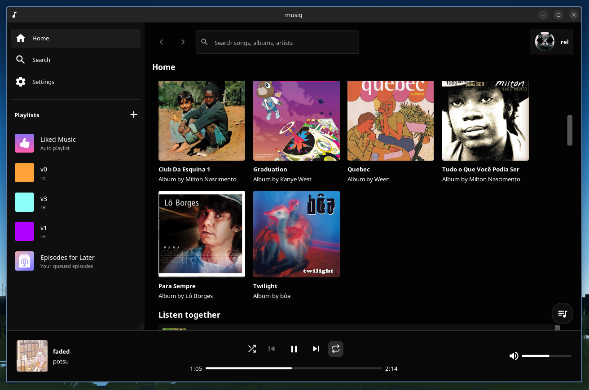
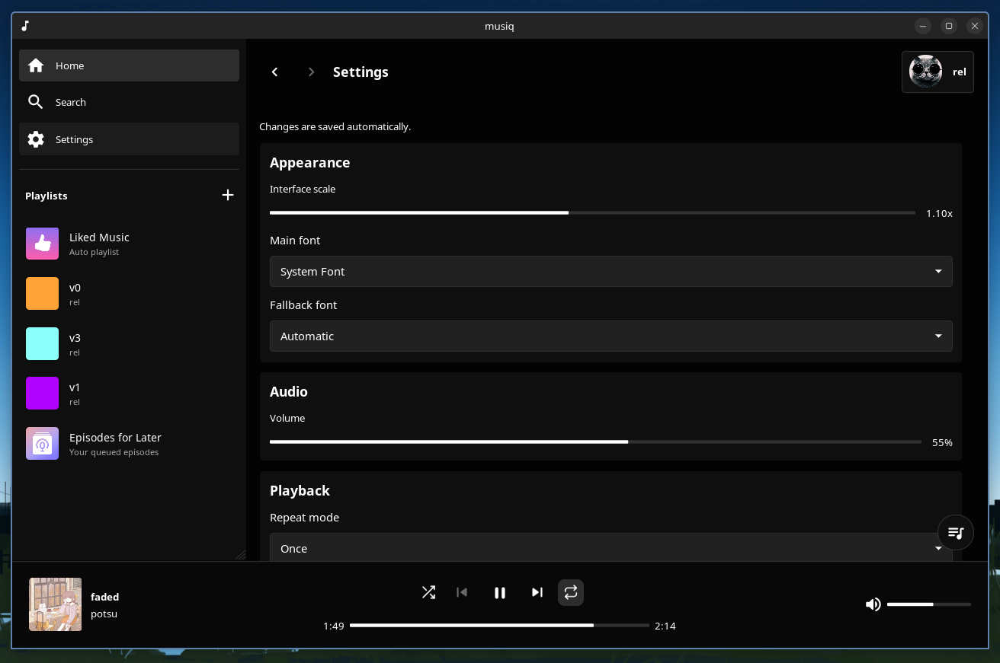
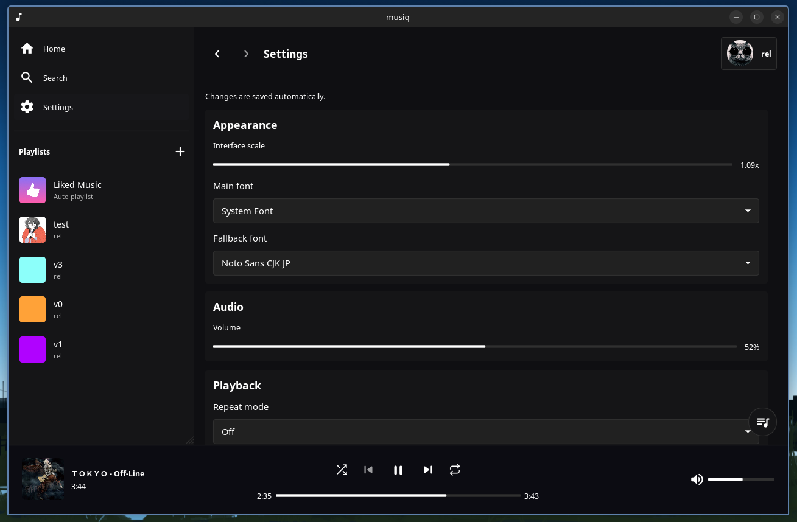
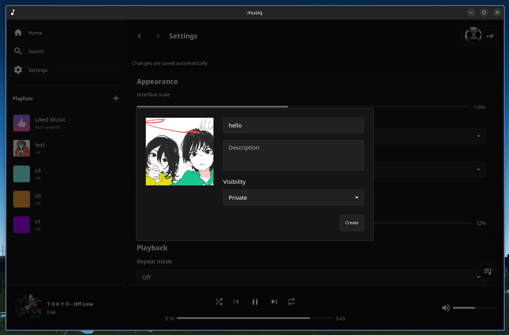

# Musiq

> [!WARNING]  
> Musiq is still in **VERY** early stages of development.

<p align="center">
    <table>
        <tr>
            <td></td>
            <td></td>
        </tr>
        <tr>
            <td></td>
            <td></td>
        </tr>
    </table>
</p>

## Download
- **latest stable version**: [download here](https://github.com/mezleca/musiq/releases/latest)

## Building

### Required
- python >= 3.10, git, cmake >= 3.25, ninja, clang >= 20, clang-format

### Linux
- sqlite3, libmpv, gtk3, webkit2gtk 4.1, sdl3 >= 3.2, freetype2, fontconfig >= 2.12, curl / OpenSSL, libsystemd >= 238

### Windows
- clang/llvm (clang-cl), meson, pkgconf and nasm

```sh
python3 ./ez init
python3 ./ez build --type release
```
